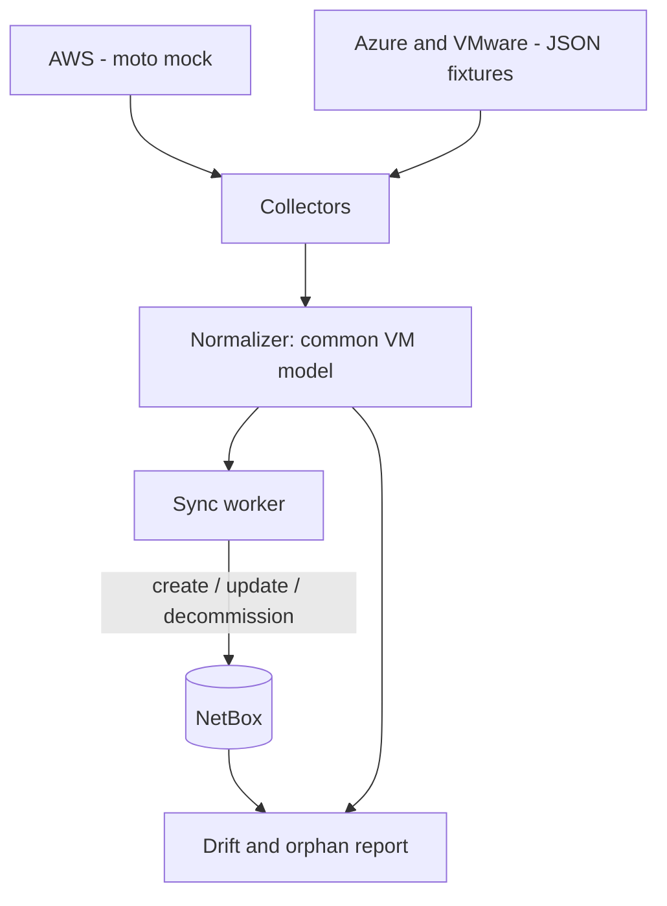

# VM Inventory Sync

Collects VM data from multiple platforms, normalizes it into one model, and syncs it into **NetBox** as the single source of truth. Includes drift and orphan reporting.

## Architecture



## How it works

1. **Collectors** (`app/collectors/`): one plugin per platform, each with a `collect() -> list[VM]` method.
2. **Normalizer** (`app/models.py`): every platform maps to one `VM` model (hostname, IPs, OS, CPU, RAM, disk, tags, owner, power state, location, source).
3. **Sync** (`app/sync.py`): VMs are matched in NetBox by `(source, external_id)` using the NetBox REST API.
   - not found: create
   - found and different: update
   - in NetBox but gone from its source: status set to `decommissioning`
4. **Report** (`python main.py report`): the same logic in dry-run mode. It prints field-level drift and orphans without writing anything.

Sync is idempotent: running it twice produces zero changes.

## Setup (Windows PowerShell, Docker Desktop and Python 3.11+ required)

1. Start NetBox and the moto AWS mock:
   ```powershell
   git clone -b release https://github.com/netbox-community/netbox-docker.git
   copy deploy\docker-compose.override.yml.example netbox-docker\docker-compose.override.yml
   cd netbox-docker
   docker compose pull
   docker compose up -d
   ```
   First boot takes 3 to 8 minutes. Wait until `docker compose ps` shows netbox as `healthy`.
2. Create an admin and an API token:
   ```powershell
   docker compose exec netbox /opt/netbox/netbox/manage.py createsuperuser
   ```
   Log in at http://localhost:8000, open your user menu, then API Tokens, and add a **v2** token. Copy it when shown.
3. Configure the app:
   ```powershell
   cd ..\app
   copy .env.example .env
   ```
   Put the token in `.env` as `NETBOX_TOKEN=nbt_...` (without the word `Bearer`).
4. Install and seed:
   ```powershell
   python -m venv .venv
   .\.venv\Scripts\Activate.ps1
   pip install -r requirements.txt
   python seed_moto.py
   ```

## Run

```powershell
python main.py report   # dry run: shows what would change
python main.py sync     # writes to NetBox
python main.py sync     # second run: unchanged=N, proves idempotency
```

## Demo: drift and decommission

```powershell
python mutate_moto.py   # changes a tag, stops one VM, terminates one VM
python main.py report   # shows 2 drifted VMs and 1 orphan
python main.py sync     # applies the changes
python main.py sync     # nothing left to change
```

View the results at http://localhost:8000/virtualization/virtual-machines/

## Design decisions

- **NetBox as source of truth**: collectors only feed the sync, and the sync only writes to NetBox.
- **Idempotent sync**: match by `(source, external_id)` and update only when a field differs.
- **Safe decommissioning**: a VM is only marked `decommissioning` if its collector ran successfully. A failed collector never causes mass decommissioning.
- **Soft delete**: orphans are flagged, not deleted, so a human can review them.
- **Mocks**: AWS runs against moto (real boto3 calls). Azure and VMware use JSON fixtures that mimic each API's field names, so the normalizer does real mapping work.

## Limitations and next steps

- Azure and VMware use fixtures, not live APIs. Real collectors would use the Azure SDK and the vSphere API behind the same `collect()` interface.
- IPs are stored in a custom field. Next step: create NetBox interfaces and IP address objects and set the primary IP.
- Runs on demand. For production, add a scheduler (cron or a queue), retries, and secrets management.
- No dashboard. A small React drift view is a possible addition.
